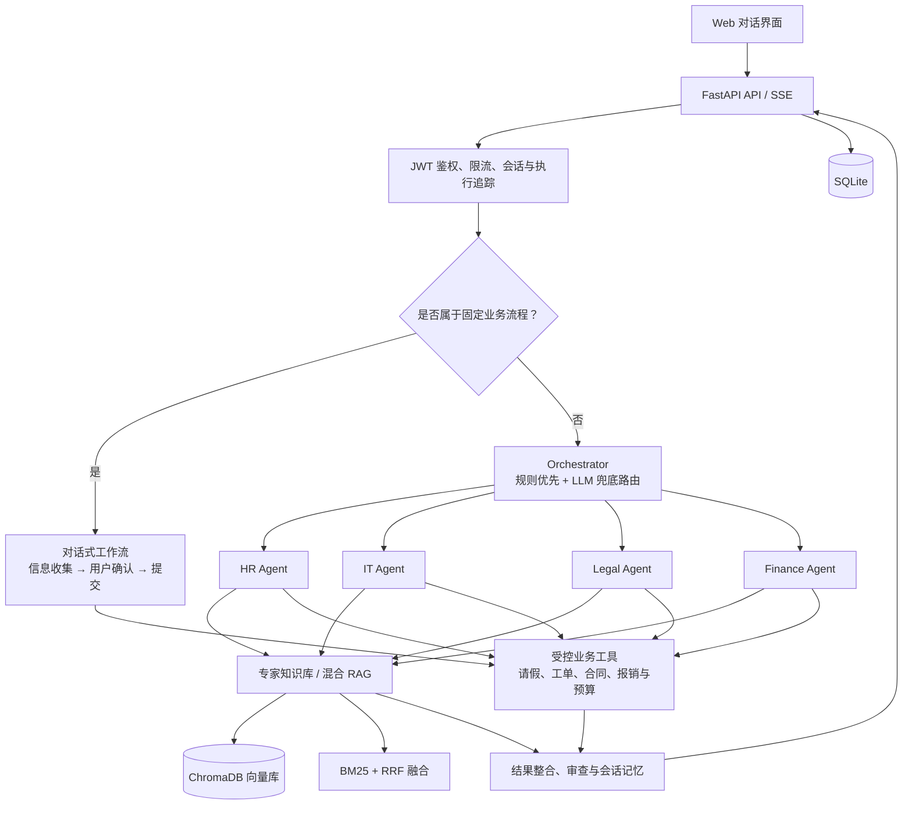

# Enterprise AI Assistant

面向企业内部员工的 AI 智能助手，覆盖 **HR、IT、法务、财务** 四类常见服务场景。系统将 RAG 知识库、LLM 工具调用和受控业务工作流整合为一个可用的 Web 应用：员工通过自然语言即可完成制度咨询、设备报修、请假、报销等任务。

> 这是一个聚焦 AI 应用工程的个人项目：重点不只是“调用模型”，而是让模型能力在企业业务中做到可检索、可控、可追踪、可确认。

## 项目亮点

- **多领域智能协作**：由 Orchestrator 识别问题领域，调度 HR、IT、法务、财务专家；跨领域请求支持并行处理与统一答案整合。
- **混合 RAG 检索**：每个专家维护独立知识库，结合 Chroma 向量检索、BM25 关键词检索和 RRF 融合，兼顾语义理解与企业制度术语的精确匹配。
- **受控工具调用**：基于手写 ReAct 循环，Agent 可查询余额、创建工单、提交报销或查询预算；设置调用上限、错误降级和调用记录。
- **对话式业务办理**：请假场景可从自然语言提取假种、日期和天数；仅追问缺失字段，并在用户确认后才提交申请。
- **面向生产体验的工程设计**：提供 JWT 鉴权、限流、SSE 流式输出、会话记忆、执行追踪与后台初始化。

## 能解决什么问题？

| 用户输入 | 系统处理方式 |
| --- | --- |
| “我今年还剩几天年假？” | 路由至 HR，查询假期余额并返回结果 |
| “笔记本蓝屏了，帮我报修” | 路由至 IT，检索报修指引并创建工单 |
| “员工数据能存到境外服务器吗？” | 路由至法务，基于数据保护制度回答 |
| “我想请 3 天年假，下周一开始” | 提取信息、追问缺失项、生成确认摘要，用户确认后提交 |
| “请病假，同时电脑需要报修” | HR 与 IT 协同处理，整合为一条清晰回复 |

## 系统架构



## 核心流程

1. 用户在聊天界面发送自然语言请求。
2. 系统优先识别是否属于确定性的业务工作流；例如请假会进入“信息收集 → 确认 → 提交”流程。
3. 其他问题由 Orchestrator 按“寒暄检测 → 关键词规则 → LLM 结构化路由”识别主专家与协作专家。
4. 专家 Agent 从所属知识库检索证据，必要时执行受控工具调用。
5. 跨领域任务并行执行或交接处理，最终由整合器生成无重复的用户答案。
6. 系统记录工具调用、检索片段和 Trace，便于复盘与调试。

## 技术栈

| 模块 | 技术 |
| --- | --- |
| 后端服务 | Python、FastAPI、SSE |
| 大模型 | DeepSeek API（OpenAI SDK 兼容接口） |
| RAG | ChromaDB、向量检索、BM25、RRF 融合、可选重排序 |
| 数据与业务工具 | SQLite、Mock 企业业务工具 |
| 安全与可观测性 | JWT、限流、Trace、会话记忆 |
| 前端与部署 | 原生 HTML/CSS/JavaScript、Docker、Docker Compose |

## 评估

项目内置离线评测脚本和测试集，用于检查路由、检索及工具调用链路。

- 最新路由报告：20 条测试样本中主路由命中 19 条，**主路由准确率 95%**。
- 当前跨领域测试样本数量有限，仍是后续重点优化项；因此该指标不等同于真实生产环境效果。

运行路由评测：

```cmd
python scripts\run_eval.py --routing-only
```

## 本地运行

### 1. 准备环境

```cmd
poetry install
copy .env.example .env
```

在 `.env` 中配置模型服务密钥：

```env
LLM_API_KEY=your_key_here
```

### 2. 启动应用

```cmd
scripts\start_local.bat
```

浏览器访问 `http://127.0.0.1:8080`。

应用采用后台初始化：页面可先访问，知识库和 Embedding 模型在后台加载；引擎未就绪时，接口会明确返回初始化状态，而不是阻塞页面。

## 公网演示（Cloudflare Tunnel）

项目支持通过 Cloudflare Tunnel 将本地服务暴露为 HTTPS 公网地址，方便面试或远程演示：

```cmd
scripts\start_tunnel.bat
```

- 临时模式会生成随机的 `*.trycloudflare.com` 地址，适合快速分享；
- 固定域名模式需要配置 Cloudflare 账号和已托管域名。

> 公网隧道依赖本地服务持续运行；临时地址会在服务停止后失效。

## 项目结构

```text
src/
├── agents/          # Orchestrator、专家 Agent、Planner、Review
├── api/             # FastAPI 路由与聊天服务
├── rag/             # 文档加载、分块、混合检索、重排序
├── tools/           # HR / IT / 法务 / 财务业务工具
├── workflow/        # 工作流引擎与对话式请假流程
├── memory/          # 会话与长期记忆
├── observability/   # Trace 追踪
└── gateway/         # JWT、限流与输入安全
frontend/            # Web 聊天界面
data/                # 模拟企业制度文档与本地业务数据
scripts/             # 启动、评测、维护脚本
```

## 说明

- 本项目使用模拟企业数据和 Mock 工具，适合作为 AI 应用工程实践与作品集展示。
- 涉及写操作的业务请求均要求用户确认；模型不会直接静默提交请假、报销或工单。
- 更多设计资料见 [`docs/`](docs/)；请勿提交真实 API Key、员工数据或生产凭据。
