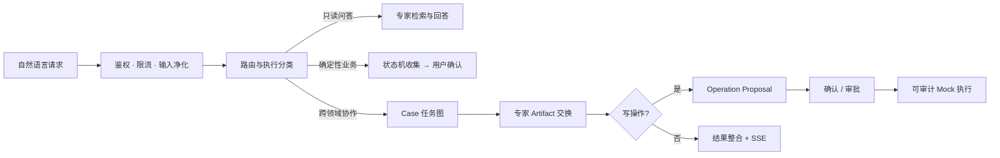
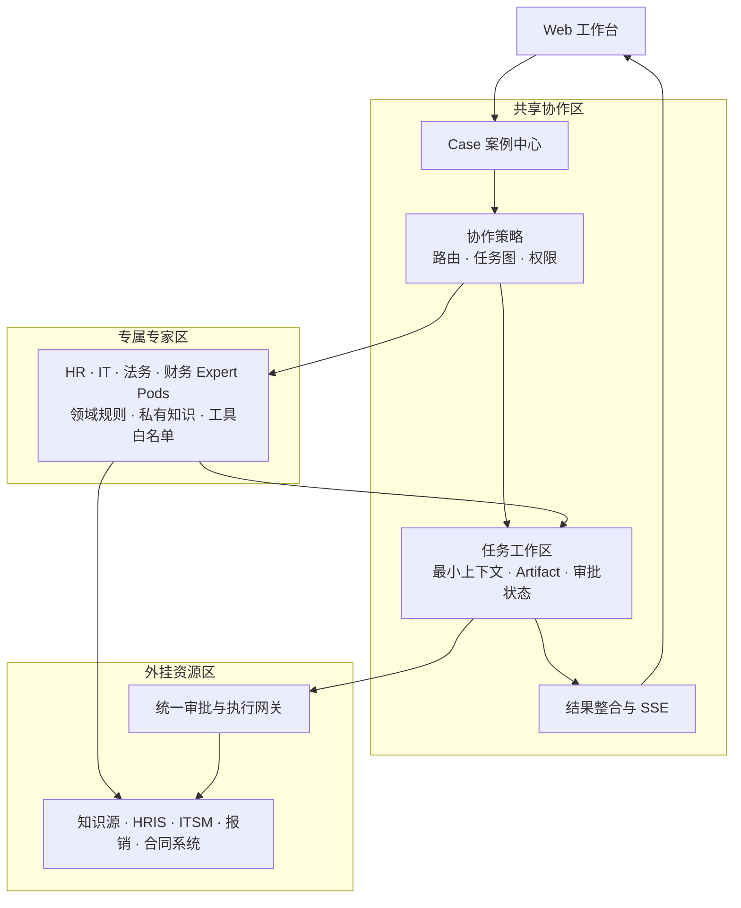

# 企业事务协同中枢（Enterprise Service Collaboration Hub）

> 面向企业内部员工的 AI 事务协同中枢：从一个自然语言请求，到可追踪、可审批、可恢复的 Case

主线是**企业事务协同中枢**：用户从自然语言发起一个 `Case`；系统根据任务的不确定性选择协作策略，组织 HR、IT、法务、财务等领域能力，把外部写操作交给确认、审批与执行网关。它不是把固定流程套上模型，也不是四个聊天机器人轮流回答，而是把 **Agent 决策**（理解目标、选择专家、整合证据）与 **Workflow 执行**（确定性步骤、人工确认、外部写入）组合起来。

[快速体验](#快速体验) · [技术架构](#技术架构) · [质量与可观测](#质量与可观测) · [本地开发](#本地开发)

> **使用边界**：系统仅使用模拟企业数据与 Mock 连接器，不连接真实 HRIS、ITSM、报销、合同等系统，也不执行任何真实外部写入。涉及写操作的请求必须经过用户确认与审批。

## 这个项目解决什么问题

跨部门请求（“请病假，同时电脑需要报修”）在传统实现里要么被拆成多个聊天窗口，要么让模型直接拼接多段回答；写操作一旦交给模型自由调用，就没有“确认 → 审批 → 执行 → 可恢复”的边界。本项目把这类请求归入**可追踪的 Case**：



为什么既有 Agent 又有 Workflow：

| 请求特征 | 协作策略 | Agent 的职责 | Workflow 的职责 |
| --- | --- | --- | --- |
| 问题边界清晰、无需写入 | 单专家知识问答 | 选择专家、检索并组织带证据的回答 | 不介入 |
| 涉及多个领域、需要统一建议 | 专家作为能力调用 | 并行调用专家，收集并整合 Artifact | 不介入 |
| 某领域需要多轮补充资料 | Handoff | 将对话暂时交给对应专家，并保持 Case 上下文 | 管理可恢复的领域状态 |
| 字段、规则与写入目标明确 | 确定性业务办理 | 提取字段、识别缺失信息、解释下一步 | 校验、确认、审批、执行与失败恢复 |

入职协同、离职协同、请假、报销和设备支持都是同一协作内核上的 Case 模板：模板只声明业务状态与受控资源，**不预先写死由哪些 Agent 参与或如何生成跨领域结论**。其中**离职协同**是严格的链式依赖示例：`财务结算` 依赖 `IT 资产回收`、它又依赖 `HR 结清`，资产回收失败会把 Case 置为 `blocked` 而不是返回半成品结论，资产收回后再解锁结算。

## 快速体验

无需手动分开启动数据库、后端和前端。Windows 下在仓库根目录执行一条命令即可启动完整服务并自动打开浏览器：

```cmd
scripts\start_local.bat
```

首次运行前，请先将 `.env.example` 复制为 `.env` 并配置模型密钥：

```cmd
copy .env.example .env
```

`start_local.bat` 会按顺序完成：定位 Python（优先 `.venv`，其次 conda `llm` 环境）→ 清理 8080 端口旧进程 → 启动 FastAPI 后端（`http://127.0.0.1:8080`，工作台由同一服务托管，含 `/docs` Swagger）→ 等待 `/api/agents` 就绪 → 自动打开浏览器。知识库与 Embedding 模型在后台初始化，页面可先访问；引擎未就绪时接口明确返回初始化状态。终端 `Ctrl+C` 停止服务。

> **关于启动方式**：本项目是纯 Python + 原生 HTML/CSS/JavaScript 的 Windows 工程，没有 Node 前端工具链，bat 脚本就是唯一的全栈启动入口——`start_local.bat` 相当于其他项目的 `npm run dev`。另有 `start_tunnel.bat`（公网演示）与 `start_e2e_demo.bat`（临时数据库 + 跳过 Agent 初始化，端口 8091）两个可选入口。

需要远程演示时，可选地执行 `scripts\start_tunnel.bat` 通过 Cloudflare Tunnel 将服务暴露为 HTTPS 公网地址：未配置固定域名时使用临时 `*.trycloudflare.com` 链接，本地服务停止后失效。

按下面顺序验证 Case 协作主链路（详见 [GitHub 演示清单](docs/GitHub演示清单.md)）：

1. **对话发起**：提出“请病假，同时电脑需要报修”，观察系统路由到 HR 与 IT 并沉淀为跨领域 Case，而不是拼接两段独立回答。
2. **入职协同**：在事务中心创建“新员工入职协同”，补充日期、岗位与部门；Case Runtime 完成 HR 前置任务，并生成 IT、法务、财务三个操作提案。
3. **确认不执行**：员工确认三个提案，系统只推进状态机，不直接调用任何写工具。
4. **审批执行**：切换 HR 账号，审批并执行 Mock 连接器；回到 Case 详情查看任务完成、事件审计与状态收敛。
5. **回归评测**：依次运行协作策略、Case 安全与 API E2E 三条评测命令（见下文）。

## 产品能力

| 能力 | 设计重点 |
| --- | --- |
| Case 优先 | 跨部门请求自动沉淀为可恢复的 Case；前端按“部门任务 / 可共享结论 / 待我确认”展示进度；私有 Artifact 不进入员工视图。 |
| 受限动态协作 | Case Manager 将路由结果转换为运行时任务图，Case Runtime 统一管理工作区、持久化和失败阻塞；未知专家与未声明资源会被拒绝。支持单专家、并行研判与 HANDOFF（单领域需多轮补充资料时交接）三种协作模式。 |
| 复杂度可观测决策 | 执行路径（知识问答 / 确定性工作流 / 跨专家协作）由显式复杂度打分（领域数、写意图、缺失字段、结构化分析）驱动，并把 `complexity_score` 透出到路由结果，而非隐式优先级。 |
| Agent 决策 + Workflow 执行 | Agent 负责理解目标、选择专家、整合证据；所有专家工具调用统一经过 Resource Gateway，写工具只生成 Operation Proposal。 |
| 三域资源隔离 | 专家 Pod 持有私有知识与工具白名单；共享区只保存最小上下文与 Artifact；外部知识库、Mock 企业系统和审批网关通过资源注册表接入。 |
| 入职/离职协同闭环 | 入职在确认日期与岗位后生成 IT 账号设备、NDA、薪资主体三个提案；离职结清经“HR → IT 资产回收 → 财务结算”严格链式依赖推进，资产未归还即阻塞并支持恢复。确认并经审批后仅执行可审计 Mock 连接器并收敛 Case 状态。 |
| 混合 RAG 与可观测性 | 领域问答采用向量检索、BM25、RRF 融合与可选重排；SSE、Trace、JWT、限流和输入净化作为运行支撑能力。 |
| 可验证边界 | 路由、协作策略、私有产物隔离、状态机和入职闭环均有离线测试与回归评测。 |

## 技术架构



专家不再直接共享完整对话或写入外部系统：跨领域协作只共享脱敏后的 Artifact；写操作必须先形成操作提案，再经过统一审批与执行网关。

- **前端**：原生 HTML/CSS/JavaScript 工作台（对话、事务中心、审批、通知、执行追踪、管理后台）
- **后端**：FastAPI + Uvicorn + SSE；手写 ReAct、领域路由、执行模式分类、Case Manager / Runtime
- **数据层**：SQLite（WAL）、ChromaDB（本地可重建检索索引，不纳入版本控制）
- **模型接入**：DeepSeek API（OpenAI SDK 兼容，支持 reasoning）
- **工程能力**：JWT 双 Token、Token Bucket 限流、输入净化、Trace JSONL、Docker Compose、Cloudflare Tunnel

## 质量与可观测

项目把“回答得像不像”与“链路是否可解释”分开处理：

- 统一 `trace_id` 关联路由、检索、工具调用、审批与执行事件，按日写入 `traces/` JSONL。
- 前端执行追踪面板只展示身份校验、上下文加载、意图识别、信息查询、回答生成等可理解阶段，不泄露工具参数或模型内部推理。
- 私有 Artifact 不进入共享上下文与员工视图；确认、审批、执行等关键事件全部落审计日志。
- 评测分三层（领域路由 / 协作策略 / Case 生命周期与安全边界），使用离线样本与 Mock 资源，衡量当前实现的回归质量，不等同于真实生产环境效果。

## 安全边界

确定性规则永远在模型之前，Agent 可以决定检索与协作策略，但不能绕过以下边界：

- **路由边界**：寒暄 → 关键词 → 上下文 → LLM 的有限路由；关键词命中即返回，0 token 消耗。
- **写操作边界**：Agent 只能产出 Operation Proposal；用户确认与审批通过前，状态机拒绝任何执行。
- **资源边界**：Resource Gateway 默认拒绝未声明资源，专家不能直接读取其他领域的私有资源。
- **隐私边界**：`private` Artifact 不进入共享上下文，也不出现在员工视图。
- **失败边界**：专家或任务失败时，持久化 Case 进入 `blocked` 并支持恢复，不返回半成品结论。
- **数据边界**：全部为模拟数据与 Mock 连接器；演示截图必须使用 Mock 员工数据并隐藏 API Key、JWT 与本机路径。

## 评估指标

口径见 [基线对比与评测说明](docs/基线对比与评测说明.md)。最近一次离线评测记录（2026-08-06，`data/eval/`）：

| 层 | 指标 | 结果 |
| --- | --- | --- |
| 领域路由（关键词层，37 条） | 路由准确率 | 37/37，0 token，平均约 0.03ms |
| 领域路由（LLM 兜底，37 条） | 路由准确率 | 37/37，平均约 0.99s |
| 检索 A/B（32 条 hard set，top-1 命中） | 混合 RAG vs 单路 | 混合 30/32（93.8%）＞ 向量 27/32（84.4%）＞ BM25 24/32（75%） |
| 完整执行（37 条） | 路由 + 检索 + 工具 | 全部通过；平均约 10.6s、约 13.3k tokens |
| 协作策略回归（4 条） | 模式选择 / 参与专家 | 4/4 |
| Case 与安全边界（7 项） | 提案 / 确认 / 审批 / 隐私 / 越权 | 7/7 |
| API E2E | 员工 + HR 双角色入职链路 | 临时 SQLite 通过 |
| 离职多跳依赖（6 项） | 链式 `depends_on` / 失败阻塞 / 恢复解锁 | 6/6（tests/test_offboarding_flow.py） |
| 复杂度决策（4 项） | `complexity_score` 打分单调性 / 路径选择 | 4/4（覆盖于 tests/test_request_dispatch.py） |

> 早期口径为 20 条路由样本命中 19 条（95%）；以上均为离线样本与 Mock 资源下的回归结果，不等同于真实生产环境效果。

运行评测：

```cmd
python scripts\run_eval.py --routing-only       :: 领域路由（秒级）
python scripts\run_eval.py --retrieval-only     :: 路由 + 检索
python scripts\run_eval.py --output report.json :: 完整评估（需配置 LLM 密钥）
python scripts\run_collaboration_eval.py        :: 协作策略回归
python scripts\run_case_eval.py                 :: Case 闭环与安全边界
python scripts\run_api_case_e2e.py              :: 临时库上的 API 端到端验证
python scripts\run_offboarding_api_e2e.py       :: 离职链式依赖 + 失败阻塞/恢复的 API 端到端验证
```

## 本地开发

### 前置条件

- Windows（bat 启动脚本为 cmd 语法）
- Python ≥3.11（优先 `.venv`，或 conda `llm` 环境）
- 可选：Poetry（依赖管理）；Cloudflare Tunnel 需要 `cloudflared`（脚本会自动下载）

### 开发模式

| 命令 | 作用 |
| --- | --- |
| `scripts\start_local.bat` | 全栈启动：后端 + 工作台 + 自动打开浏览器（8080） |
| `scripts\start_tunnel.bat` | Cloudflare Tunnel 公网演示（临时或固定域名） |
| `scripts\start_e2e_demo.bat` | 无头演示：临时数据库、跳过 Agent 初始化（8091） |
| `python scripts\run_eval.py ...` | 领域路由 / 检索 / 完整评测 |
| `python scripts\run_collaboration_eval.py` | 协作策略回归 |
| `python scripts\run_case_eval.py` | Case 闭环与安全边界 |
| `python scripts\run_api_case_e2e.py` | API 端到端验证（临时库） |
| `python scripts\run_offboarding_api_e2e.py` | 离职链式依赖 + 失败阻塞/恢复 API E2E |
| `python -m pytest -q` | 单元测试（tests/，纯内存 / 离线） |

也可以手动分步启动，效果相同：

```cmd
poetry install
copy .env.example .env
python -m uvicorn src.api.app:app --host 127.0.0.1 --port 8080
```

| 地址 | 用途 |
| --- | --- |
| `http://127.0.0.1:8080` | 工作台（对话 / 事务中心 / 审批 / 通知 / 追踪 / 管理后台） |
| `http://127.0.0.1:8080/docs` | Swagger API 文档 |
| `http://127.0.0.1:8091` | E2E 演示服务（临时数据库） |
| `traces/` | Trace JSONL（按日） |

## 项目结构

```text
src/        FastAPI、Agent 编排（路由 / 执行分类）、Case Manager/Runtime、RAG、工具与资源网关
frontend/   原生 HTML/CSS/JS 工作台（对话、Case、审批、通知、追踪、管理后台）
scripts/    启动（bat）与评测脚本
tests/      pytest（路由、协作策略、资源网关、Case 生命周期与安全边界）
docs/       产品交互、协作架构、面试讲解、基线对比与评测说明、演示清单
data/       模拟制度文档、业务数据与评测集（data/eval/）
```

## 配置与隐私

本地密钥和隧道配置均被 Git 忽略。请复制 `.env.example` 为 `.env` 后按实际环境填写：

```cmd
copy .env.example .env
```

- `.env`、`chroma_db/`、`data/*.db`、`data/backups/`、`*.pyc` 等均不纳入版本控制。
- 仓库通过 `.gitattributes`（`* text=auto` + 二进制豁免）统一行尾，避免跨平台 CRLF/LF 噪声。
- 不要提交真实 API Key、员工数据或生产凭据；演示截图使用 Mock 数据并隐藏本机路径与内部推理。
