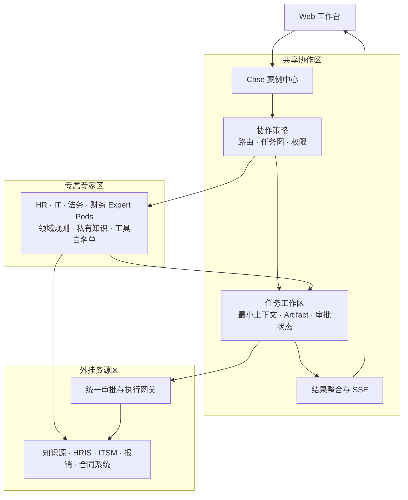

# Enterprise Service Collaboration Hub

面向企业内部员工的 AI 事务协同中枢。用户从自然语言发起一个可追踪的 `Case`；系统根据任务的不确定性选择协作策略，组织 HR、IT、法务、财务等领域能力，并将外部写操作交给受控工作流与审批网关。

> 这不是把固定流程套上模型，也不是四个聊天机器人轮流回答。项目重点是把 **Agent 决策** 与 **Workflow 执行** 组合起来：前者负责理解目标、选择专家和整合跨领域信息；后者负责确定性步骤、人工确认与外部写操作。

## 核心能力

- **Case 优先**：跨部门请求自动沉淀为可恢复的 Case，前端按“部门任务 / 可共享结论 / 待我确认”展示进度；私有 Artifact 不会出现在员工视图。
- **受限动态协作**：Case Manager 将路由结果转换为运行时任务图，Case Runtime 统一管理工作区、持久化和失败阻塞；跨领域任务并行产出结构化 Artifact，未知专家与未声明资源会被拒绝。
- **Agent 决策 + Workflow 执行**：Agent 负责理解目标、选择专家、整合证据；所有专家工具调用统一经过 Resource Gateway，写工具只生成 Operation Proposal，确定性写入由确认、审批和执行网关完成。
- **三域资源隔离**：专家 Pod 持有私有知识和工具白名单；共享区只保存最小上下文与 Artifact；外部知识库、Mock 企业系统和审批网关通过资源注册表接入。
- **混合 RAG 与可观测性**：领域问答采用向量检索、BM25、RRF 融合与重排；SSE、Trace、JWT、限流和输入净化作为运行支撑能力。
- **可验证边界**：路由、协作策略、私有产物隔离、状态机和入职闭环均有离线测试；涉及外部操作的连接器目前为 Mock 实现。

## 能解决什么问题？

| 用户输入 | 系统处理方式 |
| --- | --- |
| “我今年还剩几天年假？” | 路由至 HR，查询假期余额并返回结果 |
| “笔记本蓝屏了，帮我报修” | 路由至 IT，检索报修指引并创建工单 |
| “员工数据能存到境外服务器吗？” | 路由至法务，基于数据保护制度回答 |
| “我想请 3 天年假，下周一开始” | 提取信息、追问缺失项、生成确认卡片，用户确认后提交 |
| “帮我审批一下待办申请” | 进入审批流程，展示待审批列表与通过 / 驳回操作 |
| “请病假，同时电脑需要报修” | HR 与 IT 协同处理，整合为一条清晰回复 |

## 为什么既有 Agent 又有 Workflow？

| 请求特征 | 协作策略 | Agent 的职责 | Workflow 的职责 |
| --- | --- | --- | --- |
| 问题边界清晰、无需写入 | 单专家知识问答 | 选择专家、检索并组织带证据的回答 | 不介入 |
| 涉及多个领域、需要统一建议 | 专家作为能力调用 | 并行调用专家，收集并整合 Artifact | 不介入 |
| 某领域需要多轮补充资料 | Handoff | 将对话暂时交给对应专家，并保持 Case 上下文 | 管理可恢复的领域状态 |
| 字段、规则与写入目标明确 | 确定性业务办理 | 提取字段、识别缺失信息、解释下一步 | 校验、确认、审批、执行与失败恢复 |

入职协同、离职协同、请假、报销和设备支持都是同一协作内核上的 Case 模板。模板只声明业务状态与受控资源，**不预先写死由哪些 Agent 参与或如何生成跨领域结论**。

## 系统架构



专家不再直接共享完整对话或写入外部系统：跨领域协作只共享脱敏后的 Artifact；写操作必须先形成操作提案，再经过统一审批与执行网关。

## 核心流程

1. 用户请求先经过 JWT 鉴权、限流和输入净化，再进入领域路由。
2. Orchestrator 按“寒暄 → 关键词 → 上下文 → LLM”识别主专家与协作专家。
3. 执行分类器根据路由结果选择知识问答、确定性工作流或跨领域协作，选择原因写入 Trace。
4. 知识问答固定使用只读检索；业务办理由状态机收集字段并在用户确认后提交。
5. 跨领域查询并行调用多个专家并统一整合；跨领域写请求只返回建议和确认入口，不直接调用写工具。
6. Planner 仅处理无需确认的只读复杂查询；结果连同 Trace 通过 SSE 返回前端。

## 前端工作台

- 对话：SSE 流式对话、操作卡片、会话历史
- 事务中心：Case 列表、任务依赖、可共享专家结论和操作确认入口
- 入职演示：确认日期与岗位后生成 IT 账号设备、NDA、薪资主体三个操作提案；确认与 HR/管理员审批后，仅执行可审计的 Mock 连接器并收敛 Case 状态
- 我的申请 / 待审批：请假、报销、工单等申请与审批进度
- 通知：审批结果、待办提醒
- 执行追踪：可视化每次请求的路由、检索与工具调用
- 管理后台：用户、申请、审批、报销等数据总览

## 技术栈

| 模块 | 技术 |
| --- | --- |
| 后端服务 | Python ≥3.11、FastAPI、Uvicorn、SSE 流式 |
| 大模型 | DeepSeek API（OpenAI SDK 兼容，支持 reasoning） |
| RAG | ChromaDB + BGE Embedding、BM25（jieba 分词）、RRF 融合、查询改写、可选 BGE Cross-Encoder 重排、缓存 |
| 数据与业务 | SQLite（WAL）、Mock 企业业务工具、Skills（审批 / 工单 / 通知 / 报表） |
| Agent 编排 | 手写 ReAct、领域路由、执行模式分类、Case Manager、只读 Planner + DAG |
| 安全与可观测性 | JWT 双 Token、Token Bucket 限流、输入净化、Trace JSONL |
| 前端与部署 | 原生 HTML/CSS/JavaScript 工作台 + 管理后台、Docker、Docker Compose、Cloudflare Tunnel |

## 评估

项目内置离线评测体系（`src/evaluation/`）与 golden set（`data/eval/test_set.jsonl`，当前 37 条，覆盖 HR / IT / 法务 / 财务 / 兜底 / 跨领域）。指标包括路由准确率、检索命中与工具调用准确率。

- 路由专项评测（20 条样本）：主路由命中 19 条，**主路由准确率 95%**，其中 80% 由关键词规则层 0 token 命中。
- 跨领域样本数量有限，仍是后续重点优化项；评测指标不等同于真实生产环境效果。

运行评测：

```cmd
python scripts\run_eval.py --routing-only      :: 仅路由（秒级，不调用 LLM Agent）
python scripts\run_eval.py --retrieval-only    :: 路由 + 检索
python scripts\run_eval.py                     :: 完整评估（路由 + Agent 执行）
python scripts\run_eval.py --output report.json
python scripts\run_collaboration_eval.py             :: 协作策略与安全边界回归评测
python scripts\run_case_eval.py                      :: Case 闭环与审批/隐私边界评测
python scripts\run_api_case_e2e.py                   :: 临时数据库上的登录与 Case API 端到端验证
```

评测分为三层：领域路由、协作策略、Case 生命周期与安全边界。它们使用离线样本和 Mock 资源，衡量的是当前实现的回归质量，不等同于真实生产环境效果。

## 本地运行

### 1. 准备环境

```cmd
poetry install
copy .env.example .env
```

在 `.env` 中配置模型服务：

```env
LLM_BASE_URL=https://api.deepseek.com
LLM_MODEL=deepseek-v4-flash
LLM_API_KEY=your_key_here
```

### 2. 启动应用

```cmd
scripts\start_local.bat
```

浏览器访问 `http://127.0.0.1:8080`。

应用采用后台初始化：页面可先访问，知识库和 Embedding 模型在后台加载；引擎未就绪时，接口会明确返回初始化状态，而不是阻塞页面。

## 公网演示（Cloudflare Tunnel）

项目支持通过 Cloudflare Tunnel 将本地服务暴露为 HTTPS 公网地址，方便面试或远程演示：

```cmd
scripts\start_tunnel.bat
```

- 临时模式会生成随机的 `*.trycloudflare.com` 地址，适合快速分享；
- 固定域名模式需要配置 Cloudflare 账号和已托管域名。

> 公网隧道依赖本地服务持续运行；临时地址会在服务停止后失效。

## 项目结构

```text
src/
├── agents/          # Orchestrator（四级路由）、专家 Agent、Planner、Review、Tool Agent
├── api/             # FastAPI 路由、SSE 聊天、Trace 中间件
├── rag/             # 文档加载、分块、Embedding、混合检索、查询改写、重排序
├── tools/           # HR / IT / 法务 / 财务业务工具 + SQLite 数据层（schema / seed / queries）
├── workflow/        # 请求执行分类、DAG 引擎、事件总线、审批状态机、请假对话流
├── collaboration/   # Case Manager/Runtime、工作区、专家与资源注册、Artifact 契约
├── skills/          # 历史业务复合能力（审批/工单/通知），逐步收敛为资源适配器
├── memory/          # 三层记忆（会话窗口 / SQLite 持久化 / 长期事实）
├── observability/   # Trace 采集与存储
├── evaluation/      # 离线评测（路由 / 检索 / 工具）
├── protocol/        # Agent 通信协议（请求 / 响应 / Handoff 交割）
└── gateway/         # JWT、限流、输入净化
frontend/            # Web 工作台（对话 / 申请 / 审批 / 通知 / 追踪 / 管理后台）
data/                # 各领域制度文档、业务数据与评测集（data/eval/）
scripts/             # 启动、评测、维护脚本
docs/                # 架构、接口协议、面试讲解等设计文档
```

## 说明

- 本项目使用模拟企业数据和 Mock 工具，适合作为 AI 应用工程实践与作品集展示。
- 涉及写操作的业务请求均要求用户确认；模型不会直接静默提交请假、报销或工单。
- 跨专家咨询在登录态下会自动生成 `cross_domain_consultation` Case；也可通过 `POST /api/cases` 基于 `employee_onboarding` 模板创建入职协同事项。
- 设计入口见 [`docs/README.md`](docs/README.md)：优先阅读产品交互、协作架构、基线对比和面试讲解；请勿提交真实 API Key、员工数据或生产凭据。
