# Enterprise AI Assistant

面向企业内部员工的 AI 智能助手，覆盖 **HR、IT、法务、财务** 四类常见服务场景。系统将多 Agent 路由、混合 RAG 知识库、受控工具调用和业务工作流整合为一个可用的 Web 工作台：员工通过自然语言即可完成制度咨询、设备报修、请假申请、费用报销、审批处理等任务。

> 这是一个聚焦 AI 应用工程的个人项目：重点不只是“调用模型”，而是让模型能力在企业业务中做到可检索、可控、可追踪、可确认。

## 项目亮点

- **四级路由，确定性优先**：寒暄检测 → 关键词规则 → 短应答上下文推断 → LLM 结构化兜底；高频意图 0 token 完成路由，并支持否定句过滤、多领域消歧和主 / 协作专家选择。
- **多领域专家协作**：Orchestrator 调度 HR、IT、法务、财务四个领域 Agent，各专家拥有独立知识库与工具集；跨领域请求支持上下文交接（Handoff）与答案整合。
- **混合 RAG 管线**：FAQ 快速路径 → LLM 查询改写 → Chroma 向量检索 + BM25 关键词检索 → RRF 融合 → 可选 Cross-Encoder 重排 → 结果缓存与失败降级。
- **受控工具调用**：手写 ReAct 循环，query / action 双模式执行；工具调用统一经 Tool Agent 做参数净化、权限校验和审计，并设置调用上限、超时与错误降级。
- **对话式业务办理**：请假、报销、报修、打卡、加班、出差等场景返回可交互操作卡片，仅追问缺失字段，用户确认后才提交；审批流转由状态机严格约束。
- **Planner + DAG 工作流**：复杂多意图请求由 Planner 拆解为 DAG，工作流引擎按拓扑序调度，支持并行执行、超时重试、失败降级与状态落库。
- **Skills 复合业务层**：在原子工具之上沉淀审批引擎、工单全生命周期、通知中心与聚合报表等可复用业务能力。
- **面向生产体验的工程设计**：JWT 双 Token 鉴权、限流、输入净化、三层记忆、Review Agent 幻觉审查、SSE 流式输出、Trace 全链路追踪、后台初始化与 Docker 部署。

## 能解决什么问题？

| 用户输入 | 系统处理方式 |
| --- | --- |
| “我今年还剩几天年假？” | 路由至 HR，查询假期余额并返回结果 |
| “笔记本蓝屏了，帮我报修” | 路由至 IT，检索报修指引并创建工单 |
| “员工数据能存到境外服务器吗？” | 路由至法务，基于数据保护制度回答 |
| “我想请 3 天年假，下周一开始” | 提取信息、追问缺失项、生成确认卡片，用户确认后提交 |
| “帮我审批一下待办申请” | 进入审批流程，展示待审批列表与通过 / 驳回操作 |
| “请病假，同时电脑需要报修” | HR 与 IT 协同处理，整合为一条清晰回复 |

## 系统架构

```mermaid
flowchart TB
    UI["Web 工作台<br/>对话 · 我的申请 · 待审批 · 通知 · 追踪 · 管理后台"] --> GW["Gateway 安全网关<br/>JWT 鉴权 · 限流 · 输入净化"]
    GW --> API["FastAPI / SSE"]

    API --> Core{"请求处理方式"}
    Core -->|"寒暄 / 关键词 / 上下文"| Quick["规则路由<br/>0 token 命中"]
    Core -->|"LLM 兜底"| LLMRoute["LLM 结构化路由<br/>JSON + Pydantic 校验"]
    Quick --> Router["Orchestrator<br/>主专家 + 协作专家 + 意图分类"]
    LLMRoute --> Router

    Router --> Experts["HR · IT · 法务 · 财务专家 Agent"]
    Experts --> RAG["混合 RAG 管线<br/>改写 → 向量 + BM25 → RRF → 重排"]
    Experts --> Tools["Tool Agent<br/>权限校验 · 审计 · ReAct 调用"]
    RAG --> Data[("ChromaDB / SQLite")]
    Tools --> Data
    RAG --> Review["Review Agent<br/>规则 + LLM 双重审查"]
    Tools --> Review
    Review --> SSE["SSE 流式输出"]
    SSE --> UI

    Planner["Planner → DAG 工作流引擎"] -.-> Experts
    Memory["三层记忆 L1 / L2 / L3"] -.-> Experts
    Trace["Trace 全链路追踪"] -.-> API
    Eval["离线评测 golden set"] -.-> Router
```



## 核心流程

1. 用户在 Web 工作台发送自然语言请求，经 Gateway 完成 JWT 鉴权、限流与输入净化。
2. Orchestrator 按“寒暄 → 关键词 → 上下文 → LLM”四级路由识别主专家、协作专家与意图（query / action）；高频意图由规则直接命中，0 token 消耗。
3. 复杂多意图请求由 Planner 拆解为 DAG，工作流引擎按拓扑顺序调度执行。
4. 专家 Agent 从所属知识库混合检索证据（向量 + BM25 + RRF，可选重排），必要时进入 ReAct 工具调用循环。
5. 工具调用统一经 Tool Agent 做权限校验与审计；写操作先生成确认卡片，用户确认后才提交。
6. 跨领域任务通过 Handoff 上下文交接，由整合器生成无重复的回答；Review Agent 对数值与制度引用做规则 + LLM 双重审查。
7. 结果通过 SSE 流式推送（routing → retrieval → tool_call → reasoning → answer）。
8. 全链路事件写入 Trace，便于复盘与调试；离线评测集持续回归路由、检索与工具调用质量。

## 前端工作台

- 对话：SSE 流式对话、操作卡片、会话历史
- 我的申请 / 待审批：请假、报销、工单等申请与审批进度
- 通知：审批结果、待办提醒
- 执行追踪：可视化每次请求的路由、检索与工具调用
- 管理后台：用户、申请、审批、报销等数据总览

## 技术栈

| 模块 | 技术 |
| --- | --- |
| 后端服务 | Python ≥3.11、FastAPI、Uvicorn、SSE 流式 |
| 大模型 | DeepSeek API（OpenAI SDK 兼容，支持 reasoning） |
| RAG | ChromaDB + BGE Embedding、BM25（jieba 分词）、RRF 融合、查询改写、可选 BGE Cross-Encoder 重排、缓存 |
| 数据与业务 | SQLite（WAL）、Mock 企业业务工具、Skills（审批 / 工单 / 通知 / 报表） |
| Agent 编排 | 手写 ReAct、Orchestrator 四级路由、Planner + DAG 工作流、Review Agent、三层记忆 |
| 安全与可观测性 | JWT 双 Token、Token Bucket 限流、输入净化、Trace JSONL |
| 前端与部署 | 原生 HTML/CSS/JavaScript 工作台 + 管理后台、Docker、Docker Compose、Cloudflare Tunnel |

## 评估

项目内置离线评测体系（`src/evaluation/`）与 golden set（`data/eval/test_set.jsonl`，当前 37 条，覆盖 HR / IT / 法务 / 财务 / 兜底 / 跨领域）。指标包括路由准确率、检索命中与工具调用准确率。

- 路由专项评测（20 条样本）：主路由命中 19 条，**主路由准确率 95%**，其中 80% 由关键词规则层 0 token 命中。
- 跨领域样本数量有限，仍是后续重点优化项；评测指标不等同于真实生产环境效果。

运行评测：

```cmd
python scripts\run_eval.py --routing-only      :: 仅路由（秒级，不调用 LLM Agent）
python scripts\run_eval.py --retrieval-only    :: 路由 + 检索
python scripts\run_eval.py                     :: 完整评估（路由 + Agent 执行）
python scripts\run_eval.py --output report.json
```

## 本地运行

### 1. 准备环境

```cmd
poetry install
copy .env.example .env
```

在 `.env` 中配置模型服务：

```env
LLM_BASE_URL=https://api.deepseek.com
LLM_MODEL=deepseek-v4-flash
LLM_API_KEY=your_key_here
```

### 2. 启动应用

```cmd
scripts\start_local.bat
```

浏览器访问 `http://127.0.0.1:8080`。

应用采用后台初始化：页面可先访问，知识库和 Embedding 模型在后台加载；引擎未就绪时，接口会明确返回初始化状态，而不是阻塞页面。

## 公网演示（Cloudflare Tunnel）

项目支持通过 Cloudflare Tunnel 将本地服务暴露为 HTTPS 公网地址，方便面试或远程演示：

```cmd
scripts\start_tunnel.bat
```

- 临时模式会生成随机的 `*.trycloudflare.com` 地址，适合快速分享；
- 固定域名模式需要配置 Cloudflare 账号和已托管域名。

> 公网隧道依赖本地服务持续运行；临时地址会在服务停止后失效。

## 项目结构

```text
src/
├── agents/          # Orchestrator（四级路由）、专家 Agent、Planner、Review、Tool Agent
├── api/             # FastAPI 路由、SSE 聊天、Trace 中间件
├── rag/             # 文档加载、分块、Embedding、混合检索、查询改写、重排序
├── tools/           # HR / IT / 法务 / 财务业务工具 + SQLite 数据层（schema / seed / queries）
├── workflow/        # DAG 工作流引擎、事件总线、审批状态机、请假对话流
├── skills/          # 复合业务层：审批引擎、工单生命周期、通知中心、聚合报表
├── memory/          # 三层记忆（会话窗口 / SQLite 持久化 / 长期事实）
├── observability/   # Trace 采集与存储
├── evaluation/      # 离线评测（路由 / 检索 / 工具）
├── protocol/        # Agent 通信协议（请求 / 响应 / Handoff 交割）
└── gateway/         # JWT、限流、输入净化
frontend/            # Web 工作台（对话 / 申请 / 审批 / 通知 / 追踪 / 管理后台）
data/                # 各领域制度文档、业务数据与评测集（data/eval/）
scripts/             # 启动、评测、维护脚本
docs/                # 架构、接口协议、面试讲解等设计文档
```

## 说明

- 本项目使用模拟企业数据和 Mock 工具，适合作为 AI 应用工程实践与作品集展示。
- 涉及写操作的业务请求均要求用户确认；模型不会直接静默提交请假、报销或工单。
- 更多设计资料见 [`docs/`](docs/)（整体设计、系统架构、接口协议、面试技术文档）；请勿提交真实 API Key、员工数据或生产凭据。
