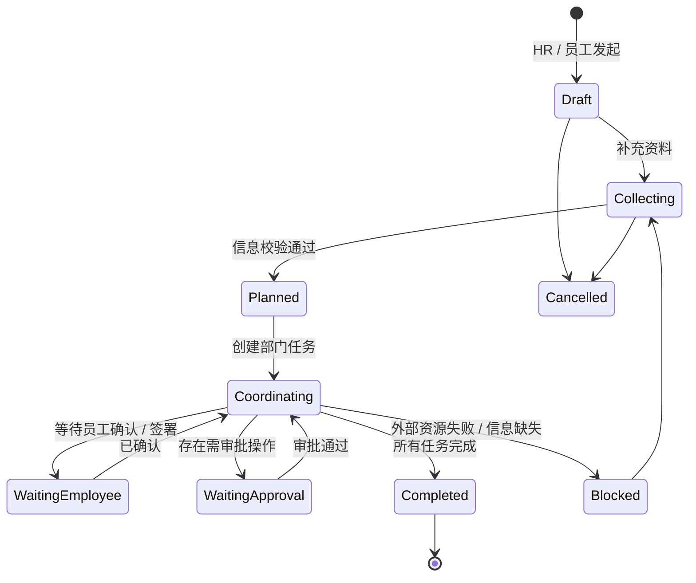

# 企业员工服务协同中枢：产品与交互设计

## 1. 产品定位

**企业员工服务协同中枢**：面向员工、HR 与管理者的内部事务工作台。用户用自然语言发起事项，系统创建一个可追踪的 `Case`，协调各部门任务、资料、审批与外部系统操作。

项目的核心不是“有四个聊天 Agent”，而是把企业内部服务从分散问答、表单和人工催办，组织成一条可确认、可协作、可审计的事务闭环。

### 范围

- **通用内核**：以 Case、任务图、Artifact、资源注册、操作提案和审批追踪组织任何企业事务。
- **旗舰 Case**：新员工入职协同，用于演示跨部门依赖、资料收集、审批与交付。
- **其他验证场景**：单部门制度咨询、跨部门研判、请假 / 报销 / 设备支持，以及后续的员工离职协同。

### 非目标

- 不模拟完整 ERP / HRIS；外部系统以受控 Mock 连接器展示。
- 不让模型决定审批结论或直接执行不可逆写操作。
- 不把专家的内部推理展示给普通用户。

## 2. 用户与价值

| 用户 | 主要目标 | 产品价值 |
| --- | --- | --- |
| 员工 | 快速发起、补充资料、知道下一步 | 一个入口查看所有事项，不必理解部门边界 |
| HR / 事务发起人 | 建立和跟踪员工事务 | 自动分派跨部门任务，减少人工催办 |
| 部门处理人 | 处理本部门待办 | 只看到与自身有关的任务、资料和操作 |
| 管理者 / 管理员 | 了解进度和风险 | 查看 Case 状态、阻塞原因、审批与审计记录 |

## 3. 信息架构

```text
工作台
├── 首页
│   ├── 自然语言发起
│   ├── 常用服务入口
│   └── 我的进行中 Case
├── Case 中心
│   ├── 全部 / 进行中 / 等待我处理 / 已完成
│   └── Case 详情
│       ├── 概览与进度
│       ├── 对话与资料补充
│       ├── 部门任务时间线
│       ├── 待确认操作
│       └── 处理详情（渐进披露）
├── 我的待办
├── 通知
└── 管理与追踪（管理员）
```

## 4. 关键页面

### 首页：发起，而非聊天空白页

首页默认展示一句清晰的引导：**“你想办理什么企业事务？”**。用户既可以自然语言输入，也可以选择入职办理、请假、报销、设备支持等快捷卡片。

输入后立即展示系统理解结果，例如：

> 已创建“新员工入职”事项，将协调 HR、IT、法务和财务。你需要先确认入职日期和岗位信息。

### Case 详情：产品核心页

```text
┌──────────────────┬──────────────────────────┬──────────────────────┐
│ 对话与资料补充     │ 任务进度与部门协作         │ 待我确认 / 相关资料     │
│                  │                          │                      │
│ 员工回答问题       │ HR  信息确认      已完成   │ [确认入职信息]          │
│ 系统追问缺失字段   │ IT  账号与设备    进行中   │ [补充设备偏好]          │
│                  │ 法务 NDA          等待签署 │ [签署 NDA]              │
│                  │ 财务 薪资主体     等待 HR  │                      │
└──────────────────┴──────────────────────────┴──────────────────────┘
```

- 左侧让用户补充信息，不承担跨部门状态展示。
- 中间用任务卡片和时间线展示“谁在处理什么、为什么被阻塞”。
- 右侧只放用户需要做的确认、资料和下载项。
- “查看处理详情”默认收起，仅向技术面试官或管理员展示资源访问、Artifact 与 Trace。

### 待办与通知

待办以动作而非部门分类，例如“补充身份证明”“确认设备型号”“签署保密协议”。通知必须带上下文和跳转目标，避免只提示“有新消息”。

## 5. 入职 Case 的状态机



任务状态统一为：`not_started`、`in_progress`、`waiting_input`、`waiting_dependency`、`waiting_approval`、`blocked`、`completed`、`cancelled`。

## 6. Agent 协作设计

### 角色边界

| 组件 | 是否为 Agent | 职责 |
| --- | --- | --- |
| Case Manager | 是 | 依据注册能力生成任务图、选择协作模式、维护 Case 生命周期 |
| HR / IT / 法务 / 财务 Expert Pod | 是 | 完成领域分析，使用私有知识与白名单资源，产出 Artifact |
| Reply Composer | 可替换为 LLM 服务 | 将已授权 Artifact 转为用户可读总结 |
| Approval Gateway | 否 | 校验确认、审批和权限，执行外部操作 |
| Resource Adapter | 否 | 适配知识库、HRIS、ITSM、合同与报销系统 |
| Trace / Policy Engine | 否 | 权限、脱敏、预算、审计与评测 |

### 协作策略

- **单部门咨询**：Case Manager 调用一个 Expert Pod，返回证据化回答。
- **确定性业务办理**：Case Manager 启动状态机；LLM 只做信息抽取和追问。
- **跨部门协作**：Case Manager 把专家作为能力调用，收集 Artifact 后统一生成任务和回复。
- **Handoff**：仅在某专家需要连续多轮收集资料时使用，例如 HR 补齐入职信息；对话控制权临时交给该专家。

Case 模板只定义可用资源、状态约束和需要确认的动作；它不等于固定的 Agent 编排图。Case Manager 必须在运行时根据用户目标、缺失信息、风险级别和专家 Artifact 选择上述策略，并且只能在已注册权限内行动。

### Artifact 示例

```json
{
  "expert_id": "it_agent",
  "facts": ["员工尚未分配企业账号"],
  "evidence_refs": ["identity_service:user:pending"],
  "recommendations": ["创建企业邮箱和 VPN 权限"],
  "operation_proposals": [
    {
      "resource_id": "itsm_ticket",
      "action": "provision_account",
      "required_approval": true
    }
  ],
  "share_scope": "team"
}
```

## 7. 体验原则

1. **Case 优先**：用户知道自己在办什么事，而不是在和哪个 Agent 说话。
2. **人话优先**：使用“IT 正在准备账号”，不用“IT Agent 正在执行 ReAct”。
3. **下一步优先**：界面最显眼的位置只展示用户当前需要做的一件事。
4. **渐进披露**：默认展示进度、任务和确认；Artifact、检索证据与 Trace 只在详情中展示。
5. **安全可见**：每个外部操作明确说明影响、执行对象、是否可撤回与确认人。
6. **失败可恢复**：资源失败时展示阻塞原因和可执行的恢复动作，而不是泛化报错。

## 8. 三分钟 Demo 脚本

1. HR 在首页发起“为张三办理 9 月 1 日入职”。
2. 系统创建入职 Case，展示 HR、IT、法务、财务任务图。
3. HR 补充岗位和部门，IT 与法务任务并行启动。
4. 员工进入 Case，确认设备偏好并签署 NDA。
5. IT、财务生成待执行操作提案；审批网关确认后执行 Mock 外部系统操作。
6. Case 完成页展示入职清单、账号状态、设备信息和完整时间线。

## 9. 开发优先级

### P0：作品集必须具备

- 首页、Case 列表、Case 详情三页。
- 入职 Case 状态机与 4 个部门任务卡。
- Case 工作区、Artifact、操作提案与审批确认。
- 一条端到端 Demo 数据链路和 Trace。

### P1：增强可信度

- 请假、报销、报修迁入同一 Case 模型。
- 角色视图与待办中心。
- 资源失败恢复、Case 搜索与统计。

### P2：后续扩展

- 离职协同、真实 MCP / API 连接器、多租户、细粒度 RBAC。
