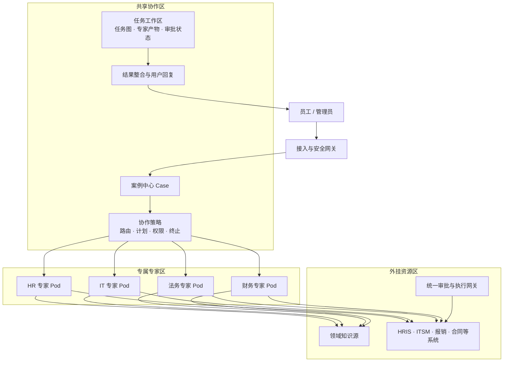

# 企业事务协作中枢：多 Agent 重构方案

## 1. 重构目标

项目不再把多 Agent 定义为“不同身份的聊天机器人”，而是定义为一个处理企业事务的协作中枢：**专家只对自己的领域负责，协作由共享工作区驱动，外部系统通过受控资源接入。**

原有“路由到 HR / IT / 法务 / 财务，然后拼接回答”的模式存在三个边界问题：

- 专家之间没有共享的任务目标、产物和依赖关系；
- 所有 Agent 都能看到近似相同的上下文，也近似拥有相同的执行自由度；
- 知识库、业务工具和审批能力散落在 Agent 内部，无法统一治理。

## 2. 目标架构



## 3. 四个区域的职责

| 区域 | 包含内容 | 不应承担的职责 |
| --- | --- | --- |
| 专属专家区 | 领域提示词、私有知识域、白名单工具、领域规则、领域状态机 | 决定全局任务、读取其他领域私有数据、直接执行高风险写操作 |
| 共享协作区 | Case、任务图、最小共享上下文、专家产物、审批状态、Trace、回复整合 | 保存全部专家私有上下文或替代领域判断 |
| 外挂资源区 | 知识源、企业业务系统、文件、搜索、MCP / API 连接器 | 直接被模型任意调用 |
| 治理区 | 身份权限、资源授权、审批、脱敏、预算、审计、评测 | 参与领域回答本身 |

## 3.1 防止退化为“配置化流程”的边界

`Case` 不是一张预先串好的审批流。它只承载目标、约束、状态和已授权的资源；协调器要根据请求和上下文选择协作策略，才能决定是否需要专家、哪些专家参与、是否并行以及是否需要补充信息。

| 层级 | 可以预配置 | 运行时决定 | 禁止由模型决定 |
| --- | --- | --- | --- |
| Case 模板 | 业务状态、所需字段、可用资源、风险规则 | 是否匹配该模板、当前缺什么信息 | 绕开模板直接写入系统 |
| 协作策略 | 路由规则、专家能力、Artifact 契约 | 专家选择、并行 / 串行、结果整合 | 任意扩大资源权限 |
| 执行流程 | 校验、确认、审批、补偿步骤 | 何时发起操作提案 | 审批结论、不可逆操作 |

因此，入职只用来验证“跨部门依赖 + 人工确认 + 多系统操作”的复杂 Case；制度咨询和跨域研判则验证没有固定流程时的专家协作能力。

## 4. 协作契约

所有专家返回结构化 **ExpertArtifact**，而不是只返回一段文字。共享区只保存可共享字段；原始检索内容、敏感参数和完整工具响应留在专家私有执行记录中。

```text
TaskCase
├── goal                 用户目标与约束
├── task_graph           子任务、依赖和状态
├── shared_context       经脱敏后的最小共享上下文
├── artifacts[]          专家产物（事实、证据、建议、风险）
├── operation_proposals  待审批的外部操作提案
└── audit                路由、访问、执行与审批追踪

ExpertArtifact
├── expert_id
├── facts[]              可验证的领域事实
├── evidence_refs[]      知识证据引用，不暴露原始敏感内容
├── recommendations[]    面向用户或下一专家的建议
├── operation_proposals[] 只描述拟执行操作，不直接写入外部系统
├── risk_flags[]
└── share_scope          public | team | private
```

## 5. 三种协作模式

### A. 专家作为能力调用（默认）

协调器保持控制权，并行或按依赖调用专家，专家回传 Artifact。适用于“请假期间电脑报修”“出差前确认预算和合规要求”等需要统一交付的任务。

当前实现由 **Case Manager** 根据路由得到的候选专家，在专家注册表白名单内生成最小任务图；跨域查询生成并行研判任务，任务完成后回写 Artifact。它不接受模型任意指定 Agent、资源或写操作，后续即使使用 LLM 生成候选计划，也必须经过同一校验。

**Case Runtime** 是协作控制平面：统一创建持久化 Case、建立最小共享工作区、归档 Artifact、推进任务状态，并在专家执行失败时将 Case 转为 `blocked`。聊天层不再自行维护一套数据库同步逻辑。

### B. 控制权交接（Handoff）

只有某位专家需要连续多轮完成明确领域流程时才交接，例如 HR 请假信息收集。此时 Case 仍归共享区管理，但该专家暂时拥有对话状态。

### C. 确定性工作流

请假、报销、报修、审批等写操作不由多个 Agent 自由讨论，而是由状态机驱动：收集字段 → 校验 → 生成操作提案 → 用户 / 审批人确认 → 执行连接器。

## 6. 资源与权限模型

资源不再隐式挂在 Agent 内部，而是通过注册表声明能力、数据范围与风险：

```text
ResourceManifest
├── resource_id          hr_policy_kb / itsm_ticket_api / approval_gateway
├── resource_type        knowledge | connector | workflow | shared_service
├── owner_domain         hr | it | legal | finance | shared
├── access_mode          read | propose_write | execute_write
├── required_scopes      employee | manager | hr_admin ...
├── sensitivity          public | internal | confidential
└── approval_required    true | false
```

专家只能请求已授权的资源；`propose_write` 只能生成 `OperationProposal`，只有统一审批与执行网关拥有 `execute_write` 权限。

## 7. 当前项目的迁移顺序

1. 引入 Case、Artifact、OperationProposal、ResourceManifest 等契约。
2. 为 HR / IT / 法务 / 财务建立专家注册表，明确私有知识域、工具白名单和共享字段。
3. 将跨域并行逻辑替换为共享工作区 + Artifact 汇总，取消直接拼接专家文本。
4. 将现有请假对话流作为第一个 Handoff 工作流；报销、报修逐步迁入确定性工作流。
5. 将现有 ChromaDB、SQLite、业务工具包装为资源注册表中的适配器。
6. 最后将 Planner 限定为 TaskGraph 生成器，只能生成已注册的资源和操作提案，不能直接写系统。

## 8. 参考实现启发

- [OpenAI Agents SDK](https://github.com/openai/openai-agents-python)：将“交接给专家”和“把专家作为工具调用”分成两种模式，适合分别处理连续领域会话与集中式协作。
- [AutoGen](https://github.com/microsoft/autogen)：将 Team、参与者、消息路由、暂停/恢复与状态持久化显式建模；企业实现应保留其状态治理思路，但避免无差别广播上下文。
- [LangGraph](https://github.com/langchain-ai/langgraph)：以状态图、分支和子图组织复杂 Agent 流程，适合承载本项目的任务图和确定性流程边界。
